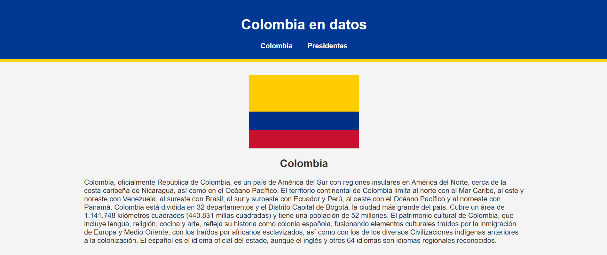
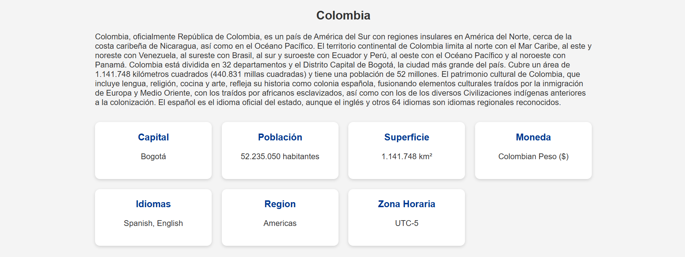
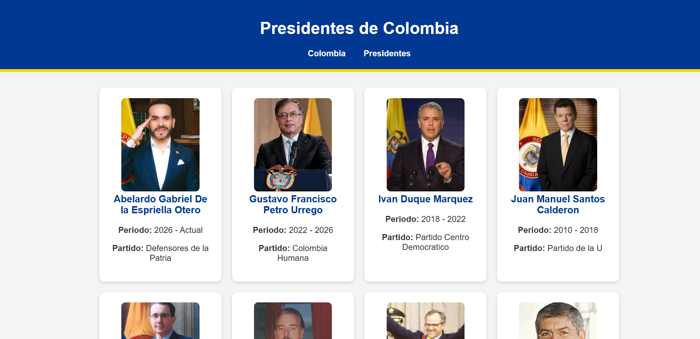
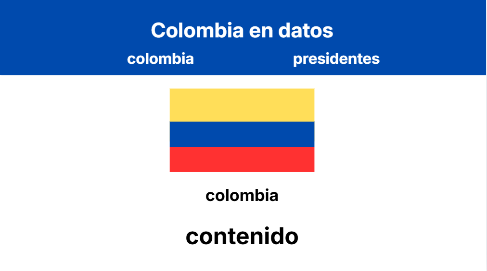
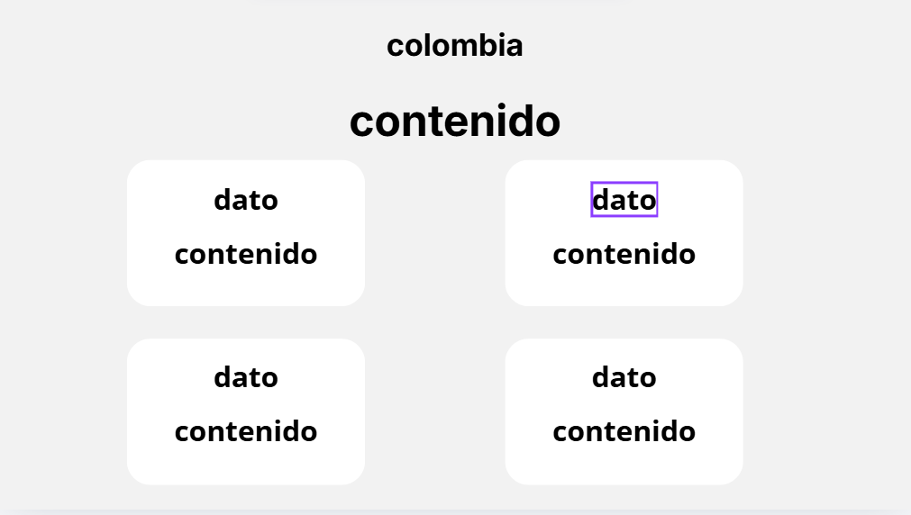
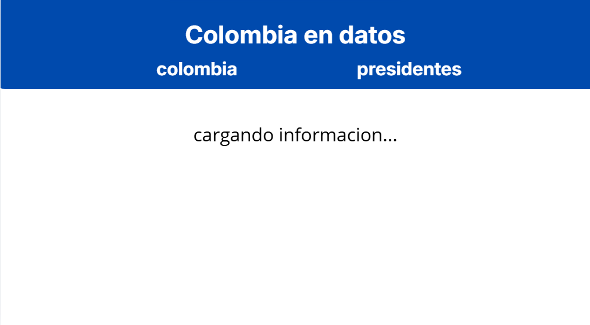
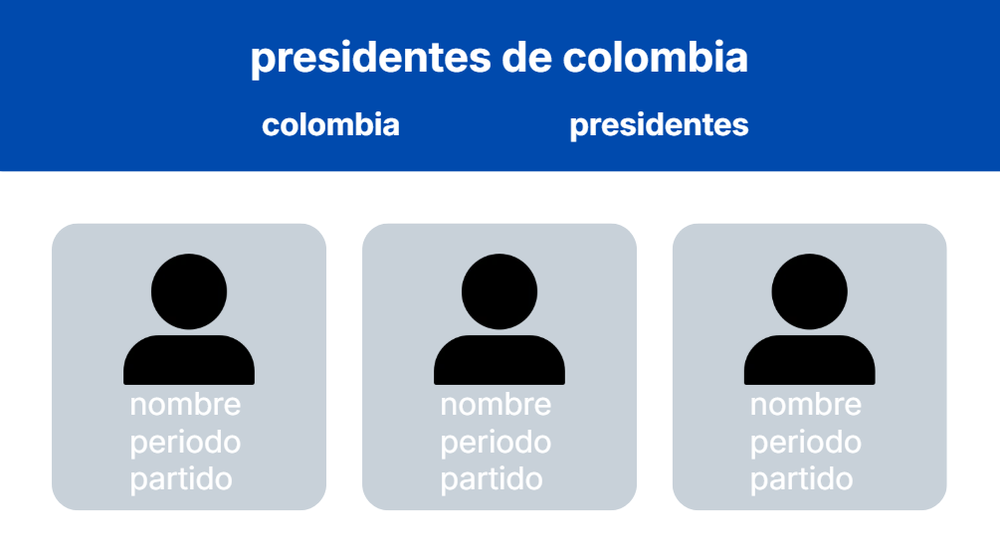

# Mini Portal de Colombia 🇨🇴

## Descripción
colombia api es una pagina que muestra informacion general y datos sobre la cultura y politica de colombia mediante una api

## Páginas
- **Colombia en datos** (`index.html`): muestra datos sobre colombia
- **Presidentes de Colombia** (`presidentes.html`): muestra a todos los presidentes que ha tenido colombia a lo largo de su historia, con su nombre,foto,partido politico y tiempo de mandato

## Tecnologías usadas
- HTML5
- CSS3
- JavaScript (fetch, manipulación del DOM)
- [API Colombia](https://api-colombia.com/)
- Git y GitHub

## Capturas

## Mockups

## Instrucciones de uso
1. Descargar o clonar este repositorio.
2. Abrir el archivo `index.html` en el navegador.
3. Usar el menú superior para navegar entre las páginas.

> Se necesita conexión a internet, porque los datos se cargan desde la API.

## Nota sobre las imágenes
Muchas fotos de presidentes que trae la API no cargaban, así que se reemplazaron por imágenes buscadas en internet, usando el objeto `fotosNuevas` en `presidentes.js`.

## Autor
David ricardo lopez